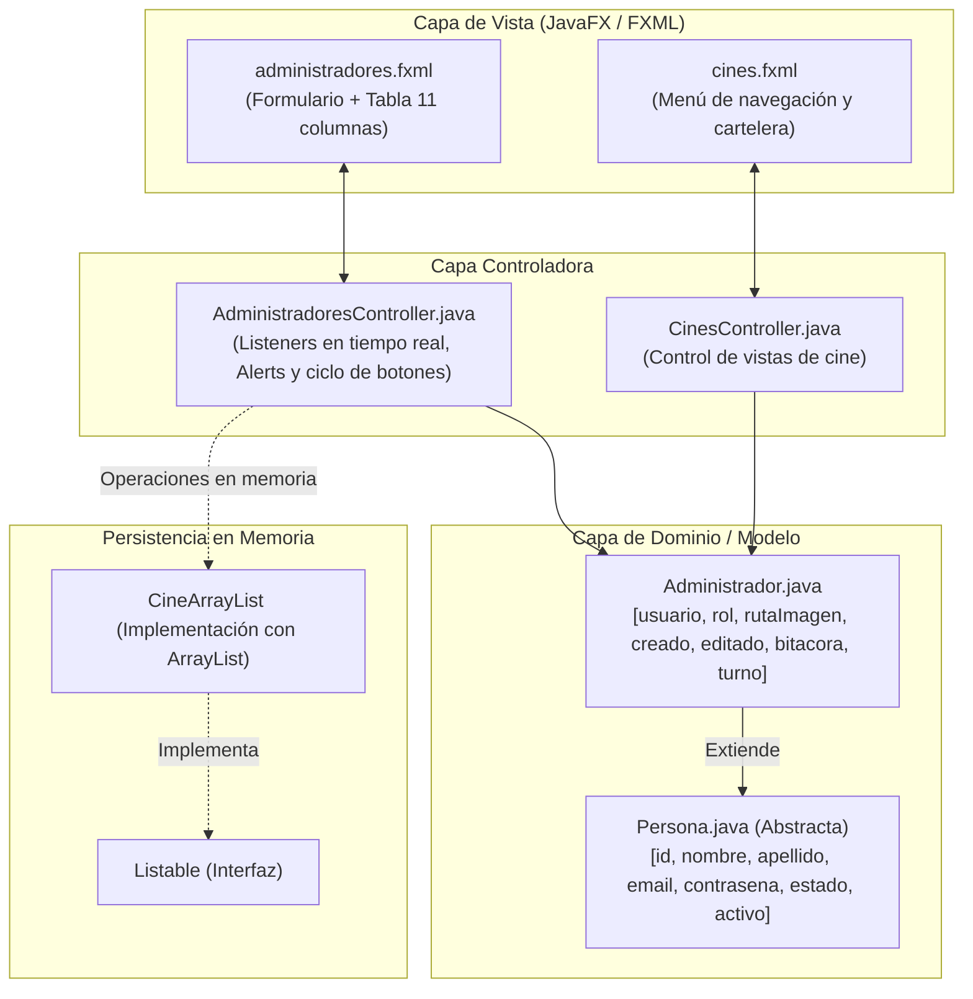

# Reporte de Implementación: Actividad 3.2 - Validación de Vistas
**Materia:** Programación Orientada a Objetos (DSM 3°B TM)  
**Proyecto:** Sistema de Gestión de Cine y Taquilla (JavaFX + Maven)  
**Autor:** Leonardo David  
**Fecha:** Octubre 2026  

---

## 1. Resumen Ejecutivo y Objetivos

El presente documento detalla la implementación técnica realizada para dar cumplimiento integral a la **Actividad 3.2: Validación de Vistas (individual)**. La práctica tiene como meta implementar validaciones en tiempo real y control de eventos en interfaces JavaFX, asegurando que:

1. Los campos no admitan valores vacíos cuando son obligatorios ni caracteres incompatibles con su tipo de dato.
2. Cada control posea un `Label` dedicado debajo para mostrar mensajes de advertencia o formato en color rojo.
3. Los mensajes de error se actualicen y desaparezcan automáticamente conforme el usuario escribe o corrige su entrada.
4. El ciclo de vida de los botones responda estrictamente a las acciones del usuario:
   - **Nuevo** y **Validar**: Habilitados al inicio.
   - **Guardar**: Deshabilitado hasta que todo el formulario sea válido.
   - **Editar** y **Eliminar**: Deshabilitados hasta que se seleccione una fila en la tabla.
   - **Limpiar / Cancelar**: Restablece el formulario y los botones a su estado inicial.
5. Se integren las **11 columnas** correspondientes a la tabla `administradores` de la base de datos MySQL (`poo3bdsm`), operando en memoria y sin conexión directa a la base de datos, preservando la arquitectura MVC.



---

## 2. Mapeo de Columnas de la Base de Datos MySQL (`poo3bdsm.administradores`)

A partir del esquema visualizado en phpMyAdmin, se incorporaron todas las columnas requeridas:

| # | Columna BD | Tipo Java | Mapeo en Modelo | Control en FXML | Regla de Validación en Tiempo Real |
|:---:|:---|:---|:---|:---|:---|
| **1** | `id` | `int` | `Persona.id` | `TextField fx:id="txtId"` | Entero positivo estrictamente mayor a 0. |
| **2** | `usuario` | `String` | `Administrador.usuario` | `TextField fx:id="txtUsuario"` | Obligatorio, alfanumérico de 3 a 20 caracteres sin espacios. |
| **3** | `nombres` | `String` | `Persona.nombre` / `nombres` | `TextField fx:id="txtNombres"` | Obligatorio, solo letras y espacios (permite acentos). |
| **4** | `apellidos` | `String` | `Persona.apellido` / `apellidos` | `TextField fx:id="txtApellidos"` | Obligatorio, solo letras y espacios (permite acentos). |
| **5** | `correo` | `String` | `Persona.email` / `correo` | `TextField fx:id="txtCorreo"` | Obligatorio, formato RFC con `@` y dominio válido. |
| **6** | `contrasena` | `String` | `Persona.contrasena` | `PasswordField fx:id="txtContrasena"` | Obligatorio, mínimo 6 caracteres. |
| **7** | `rol` | `String` | `Administrador.rol` | `ComboBox fx:id="cmbRol"` | Obligatorio, selección requerida. |
| **8** | `ruta_imagen` | `String` | `Administrador.rutaImagen` | `ImageView` + `FileChooser` | Opcional (valor por defecto `default_user.png`). |
| **9** | `estado` | `String` | `Persona.estado` | `ComboBox fx:id="cmbEstado"` | Obligatorio, selección requerida (Activo/Inactivo). |
| **10** | `creado` | `String` | `Administrador.creado` | `TextField fx:id="txtCreado"` | Automático (Timestamp `yyyy-MM-dd HH:mm:ss`). |
| **11** | `editado` | `String` | `Administrador.editado` | `TextField fx:id="txtEditado"` | Automático (Timestamp de última actualización). |

---

## 3. Arquitectura y Código Implementado

### 3.1. Modelo: [`Administrador.java`](file:///C:/Users/Fordiis/Documents/NetBeansProjects/Cine/src/main/java/com/mycompany/cine/modelo/Administrador.java)

Se ampliaron los atributos de la clase conservando el contrato de la jerarquía de `Persona` y las reglas de diseño del proyecto:

```java
package com.mycompany.cine.modelo;

public final class Administrador extends Persona {
    
    private String usuario;
    private String rol;
    private String rutaImagen;
    private String creado;
    private String editado;
    private String nivelAcceso;
    private List<String> bitacora = new ArrayList<>();
    private String estadoTurno = "En turno";

    public Administrador() {
        super();
    }

    public Administrador(int id, String usuario, String nombres, String apellidos, String correo,
                         String contrasena, String rol, String rutaImagen, String estado,
                         String creado, String editado) {
        super(id, nombres, apellidos, correo, contrasena, estado);
        this.usuario = usuario;
        this.rol = rol;
        this.nivelAcceso = rol;
        this.rutaImagen = rutaImagen;
        this.creado = creado;
        this.editado = editado;
    }

    // Getters y Setters completos para las 11 columnas
    // ...
}
```

### 3.2. Modelo: [`Persona.java`](file:///C:/Users/Fordiis/Documents/NetBeansProjects/Cine/src/main/java/com/mycompany/cine/modelo/Persona.java)

Se definieron métodos delegados (`getNombres`, `getApellidos`, `getCorreo`) para vincular fluidamente con los nombres de columna de la tabla mediante `PropertyValueFactory`:

```java
    public String getNombres() { return getNombre(); }
    public void setNombres(String nombres) { setNombre(nombres); }

    public String getApellidos() { return getApellido(); }
    public void setApellidos(String apellidos) { setApellido(apellidos); }

    public String getCorreo() { return getEmail(); }
    public void setCorreo(String correo) { setEmail(correo); }
```

### 3.3. Vista: [`administradores.fxml`](file:///C:/Users/Fordiis/Documents/NetBeansProjects/Cine/src/main/resources/com/mycompany/cine/administradores.fxml)

La vista fue estructurada en un `BorderPane` que incorpora:
- **Barra Superior:** Título temático y botón de navegación para regresar a `cines.fxml`.
- **Panel Izquierdo:** `ScrollPane` con tarjeta de formulario que ubica cada control y su correspondiente `Label` de error:
  ```xml
  <VBox spacing="2.0">
     <Label text="Correo Electrónico *:" textFill="#334155" />
     <TextField fx:id="txtCorreo" promptText="Ej. usuario@cine.com" />
     <Label fx:id="lblErrorCorreo" managed="false" text="Este campo es obligatorio." textFill="#dc2626" visible="false">
        <font><Font size="11.0" /></font>
     </Label>
  </VBox>
  ```
- **Panel de Botones:** `btnNuevo`, `btnValidar`, `btnGuardar`, `btnEditar`, `btnEliminar`, `btnLimpiar`.
- **Panel Derecho:** `TableView fx:id="tblAdministradores"` con las 11 columnas configuradas.

### 3.4. Controlador: [`AdministradoresController.java`](file:///C:/Users/Fordiis/Documents/NetBeansProjects/Cine/src/main/java/com/mycompany/cine/controladores/AdministradoresController.java)

Implementa la lógica reactiva requerida:
- **Comprobación reactiva:** Los métodos `validarId()`, `validarUsuario()`, `validarNombres()`, etc., evalúan cada tecla pulsada mediante `textProperty().addListener(...)`.
- **Ocultamiento/Aparición de errores:** Utiliza `label.setVisible(true)` y `label.setManaged(true)` únicamente ante fallas; cuando el texto es correcto, se apagan para mantener la estética limpia.
- **Validación con Alerta JavaFX:**
  ```java
  @FXML
  private void handleValidar(ActionEvent event) {
      if (esFormularioValido()) {
          mostrarAlerta(AlertType.INFORMATION, "Validación Exitosa",
                        "Comprobación de Campos Completa",
                        "Todos los datos cumplen las validaciones correctamente.");
      } else {
          mostrarAlerta(AlertType.WARNING, "Errores en el Formulario",
                        "Campos incompletos o con formato incorrecto",
                        "Por favor revisa los mensajes de error mostrados debajo de cada campo.");
      }
  }
  ```
- **Control de estado de botones:**
  ```java
  private void restablecerEstadoInicialBotones() {
      btnNuevo.setDisable(false);
      btnValidar.setDisable(false);
      btnGuardar.setDisable(true);
      btnEditar.setDisable(true);
      btnEliminar.setDisable(true);
  }
  ```
- **Habilitación de Guardar:** `btnGuardar.setDisable(!esFormularioValido())` se invoca en tiempo real tras cada modificación de texto.

---

## 4. Evidencia de Pruebas Automatizadas

Se crearon y ejecutaron con éxito **59 pruebas unitarias** que comprueban rigurosamente los requerimientos:

```text
-------------------------------------------------------
 T E S T S
-------------------------------------------------------
Running com.mycompany.cine.controladores.AdministradoresFXMLStructureTest
Tests run: 2, Failures: 0, Errors: 0, Skipped: 0
Running com.mycompany.cine.controladores.ValidacionesActividad32Test
Tests run: 54, Failures: 0, Errors: 0, Skipped: 0
Running com.mycompany.cine.modelo.AdministradorTest
Tests run: 3, Failures: 0, Errors: 0, Skipped: 0

Results:
Tests run: 59, Failures: 0, Errors: 0, Skipped: 0

[INFO] ------------------------------------------------------------------------
[INFO] BUILD SUCCESS
[INFO] ------------------------------------------------------------------------
```

### Matriz de Pruebas Cubiertas

| Clase de Prueba | Casos Ejecutados | Aspecto Evaluado |
|:---|:---:|:---|
| [`ValidacionesActividad32Test`](file:///C:/Users/Fordiis/Documents/NetBeansProjects/Cine/src/test/java/com/mycompany/cine/controladores/ValidacionesActividad32Test.java) | **54** | Validaciones parametrizadas de ID (positivos vs letras/negativos/cero), usuarios (3-20 alfanumérico vs cortos/espacios), nombres y apellidos (letras y acentos vs números/símbolos), correo (RFC con @ vs dominios incompletos), contraseñas (mínimo 6 chars), estado habilitado/deshabilitado de `btnGuardar`, y operaciones CRUD en memoria con `CineArrayList`. |
| [`AdministradorTest`](file:///C:/Users/Fordiis/Documents/NetBeansProjects/Cine/src/test/java/com/mycompany/cine/modelo/AdministradorTest.java) | **3** | Instanciación con las 11 columnas de base de datos, mutación con getters/setters y compatibilidad con constructores previos. |
| [`AdministradoresFXMLStructureTest`](file:///C:/Users/Fordiis/Documents/NetBeansProjects/Cine/src/test/java/com/mycompany/cine/controladores/AdministradoresFXMLStructureTest.java) | **2** | Verificación de sintaxis XML en `administradores.fxml`, existencia de los 22 controles y las 11 columnas de la tabla. |

---

## 5. Guía para la Demostración en Video (Rúbrica de la Actividad)

Para la grabación del video demostrativo solicitado por el docente, se sugiere seguir esta secuencia:

1. **Mostrar estado inicial de los botones:**
   - Observar que **Nuevo** y **Validar** están habilitados; **Guardar**, **Editar** y **Eliminar** están deshabilitados.
2. **Campos vacíos y mensajes de error:**
   - Escribir en un campo y borrarlo para apreciar cómo aparece el mensaje en rojo *«Este campo es obligatorio.»* debajo del control.
3. **Entradas con formato incorrecto:**
   - En **ID**: ingresar letras o números negativos -> se muestra *«Debe ser un número entero mayor que 0.»*
   - En **Nombres / Apellidos**: ingresar números (ej. `Carlos123`) -> se muestra *«Solo se admiten letras y espacios.»*
   - En **Correo**: escribir sin `@` o sin dominio -> se muestra *«Formato de correo no válido...»*
   - En **Contraseña**: escribir menos de 6 caracteres -> se muestra *«La contraseña debe tener al menos 6 caracteres.»*
4. **Habilitación de Guardar:**
   - Llenar todos los campos correctamente -> observar cómo desaparecen todos los mensajes en rojo y el botón **Guardar** se habilita de forma automática.
5. **Comprobación con botón Validar:**
   - Con todos los campos válidos, pulsar **Validar** -> se muestra la alerta emergente `Alert` indicando: *«Todos los datos cumplen las validaciones correctamente.»*
6. **Selección en Tabla:**
   - Hacer clic en un registro de la tabla -> los datos se cargan en el formulario y los botones **Editar** y **Eliminar** se habilitan.
7. **Botón Limpiar / Cancelar y Nuevo:**
   - Pulsar **Limpiar** o **Nuevo** -> el formulario queda vacío, los errores se ocultan y los botones regresan al estado inicial.

---

## 6. Comandos de Compilación y Ejecución

```bash
# Compilar proyecto y verificar clases:
mvn compile

# Ejecutar las 59 pruebas unitarias automatizadas:
mvn test

# Ejecutar la aplicación JavaFX:
mvn clean javafx:run
```
